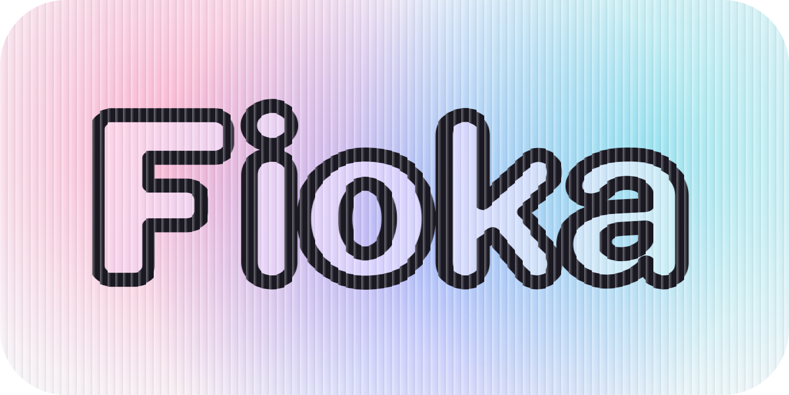
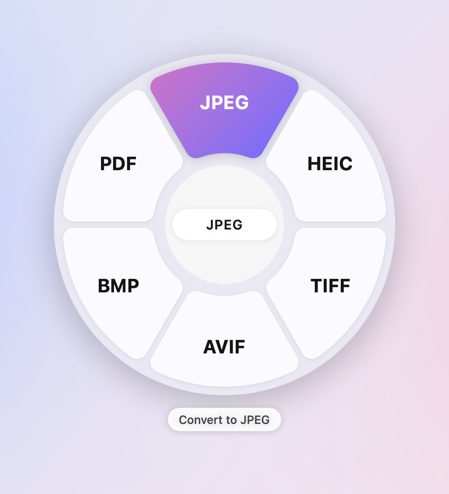
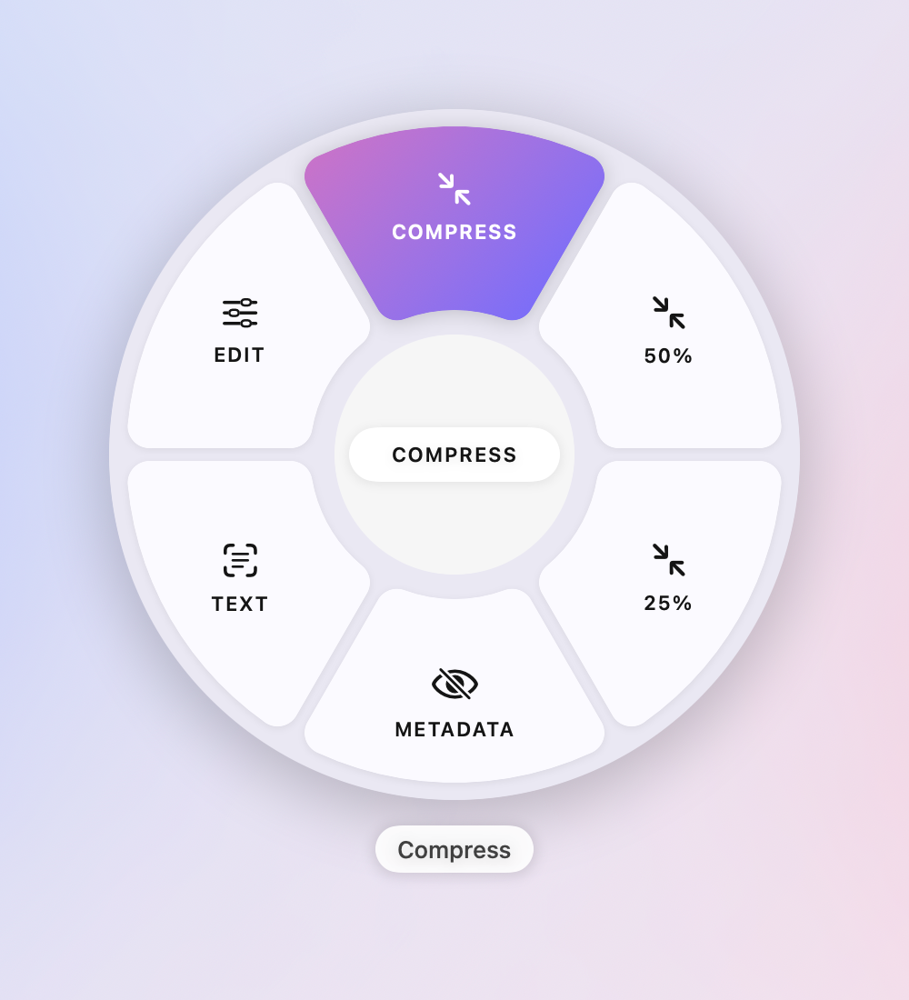
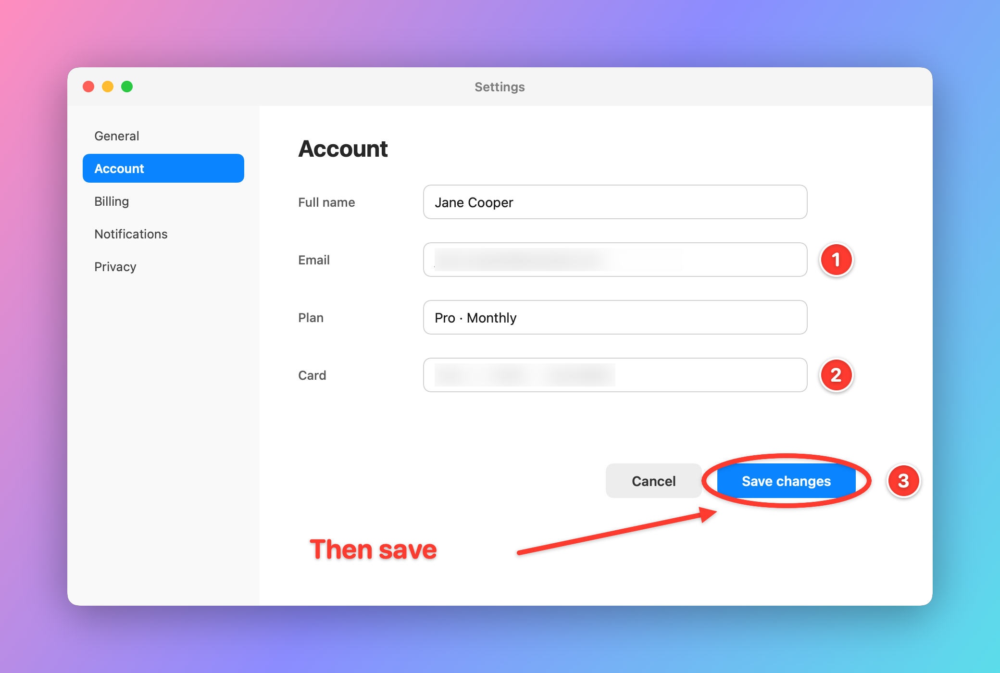

<p align="center">
  
</p>

<p align="center">
  <b>Copy, convert, capture.</b><br>
  Clipboard history as cards, screen text capture, a screenshot editor,<br>
  and a drag-and-drop converter for images, video, audio, PDFs and documents.
</p>

<p align="center">
  <a href="https://n0n0bt.github.io/fioka/"><b>Website</b></a> ·
  <a href="https://n0n0bt.github.io/fioka/#try">Try the converter in your browser</a> ·
  <a href="#install">Install</a>
</p>

<p align="center">
  <i>Fioka</i> (фиока) is Macedonian for "drawer".
</p>

---

## What it does

### Clipboard history, as cards

Press **⇧⌘V** and your clipboard history slides up from the bottom of the
screen as a revolver of cards: the newest faces you, the rest wait on a drum
to either side, and the arrow keys or a swipe turn it. Cards are text, code,
links, files, images and colours, each tinted by the app it came from. Type to
search, **Enter** to paste into the app you were in, **⌥P** to pin, **⌘1–9** to pick
by number.

<p align="center">
  
</p>

Right-click a card, or press **⌘K**, for quick actions: convert, compress or
resize an image, save it, AirDrop it, copy a file's path, reveal it in Finder,
or open its folder in Terminal.

### The drop wheel

Start dragging files anywhere, from Finder, the desktop or another app, and
tap a key. A wheel opens under the cursor; drop on a slice. You can [try it on the
website](https://n0n0bt.github.io/fioka/#try), on a pretend desktop, without
installing anything.

<p align="center">
  
  &nbsp;&nbsp;
  
</p>

| Key | Wheel |
|---|---|
| **⇧** | Convert to another format |
| **⌘** | Tools that keep the format |
| **⌃** | Actions: AirDrop, copy, copy path, zip, open in Terminal |
| **Esc** | Close the wheel |

| Files | ⇧ Formats | ⌘ Tools |
|---|---|---|
| Images | PNG, JPEG, HEIC, WebP, TIFF, AVIF, BMP, PDF | Compress, combine into one PDF, resize, remove metadata, copy text (OCR), edit |
| Video | MP4, MOV, M4V, GIF, M4A | Compress (HEVC), 720p, mute, save a frame |
| Audio | M4A, WAV, AIFF, FLAC, ALAC | Compress, mono, normalize |
| PDF | PNG, JPEG (per page), TXT, DOCX, RTF | Compress, merge (images can be mixed in), split, rotate, copy text |
| Documents | PDF, DOCX, DOC, RTF, ODT, HTML, TXT | Copy text |
| Subtitles | SRT, VTT, TXT | |
| Zip | Extract | |

Results are saved next to the original, never overwriting it, and are put on
the clipboard. Everything runs locally with what macOS already has; nothing is
uploaded, and there are no conversion limits. WebP and AVIF appear when your
macOS version can write them; MP3, Ogg and WMA can be read but not written.

### Screenshot editor

Press **⌃⌥⌘4**, select an area (Space switches to window capture), and the
capture opens in an editor.

<p align="center">
  
</p>

- **Annotate:** draw, line, arrow, box, ellipse, highlight, text, numbered steps
- **Hide and focus:** spotlight, pixelate, blur
- **Frame it:** crop; gradient, solid or blurred-screenshot backgrounds;
  padding, shadow and corner radius; canvas sizes 1:1, 4:3, 16:9 and 9:16

Copy puts the result on the clipboard at full resolution; Save writes a PNG.
Any image can be opened in the editor from the drop wheel's **Edit** tool.

### Text from anywhere on screen

Press **⌘⇧2** and drag over anything: an image, a video, a UI that won't let
you select. The recognised text goes straight to the clipboard.

## Install

**Requirements:** macOS 14 or later.

### Download

Get `Fioka-<version>.dmg` from the
[latest release](https://github.com/n0n0bt/fioka/releases/latest), open it and
drag Fioka to Applications.

Fioka is not notarized by Apple (that needs a paid developer account), so the
first time you open it macOS says it cannot check it for malware. Click
**Done**, then open **System Settings → Privacy & Security**, scroll down to
the message about Fioka and click **Open Anyway**. You only do this once.

Then grant two permissions in the same **Privacy & Security** pane:

- **Accessibility**, to paste into other apps
- **Screen Recording**, for text capture and screenshots

### Build from source

You need Xcode 26 or later.

```bash
git clone https://github.com/n0n0bt/fioka.git
cd fioka
./install.sh
```

`install.sh` builds a Release build, signs it, installs it to `/Applications`
and launches it. Grant the two permissions above.

macOS ties these permissions to the app's code signature. An ad-hoc signature
changes with every build, so you would have to grant them again after each
rebuild. To avoid that, create a self-signed code-signing certificate in
Keychain Access (Certificate Assistant → Create a Certificate, type *Code
Signing*) and pass its SHA-1 to the script:

```bash
FIOKA_SIGN_ID=<certificate SHA-1> ./install.sh
```

Without one, the script falls back to ad-hoc signing and still works.

`./release.sh` builds the universal `.dmg` that goes on the releases page.

Coming from Maccy? Fioka copies Maccy's history, settings and shortcuts on its
first launch. Maccy's own data is left untouched; if you keep both, give one
of them a different shortcut.

### Privacy

Everything stays on your Mac. History is stored in
`~/Library/Application Support/Fioka`, conversions run on macOS's own
frameworks, and Fioka makes no network requests of its own. Copies that
password managers mark as concealed are never saved, and Settings let you
ignore whole apps and clear the history.

## Development

```bash
xcodebuild test -project Fioka.xcodeproj -scheme Fioka \
  -derivedDataPath ./build \
  CODE_SIGN_IDENTITY="-" CODE_SIGNING_REQUIRED=NO CODE_SIGNING_ALLOWED=YES
```

[`CLAUDE.md`](CLAUDE.md) describes the architecture and the non-obvious parts. The icon and logos are
drawn by the scripts in [`Brand/source`](Brand/source).

## Credits

Fioka is a fork of [**Maccy**](https://github.com/p0deje/Maccy) by Alex
Rodionov: the clipboard engine, storage, search and settings are his work.
Thank you.

Built with [Defaults](https://github.com/sindresorhus/Defaults),
[KeyboardShortcuts](https://github.com/sindresorhus/KeyboardShortcuts),
[LaunchAtLogin](https://github.com/sindresorhus/LaunchAtLogin-Modern) and
[Settings](https://github.com/sindresorhus/Settings) by Sindre Sorhus,
[Sauce](https://github.com/Clipy/Sauce), [Fuse](https://github.com/krisk/fuse-swift),
[Sparkle](https://github.com/sparkle-project/Sparkle),
[SwiftHEXColors](https://github.com/thii/SwiftHEXColors) and
[swift-log](https://github.com/apple/swift-log).

## License

[MIT](LICENSE). Copyright © 2026 Naumche Joshevski, and © 2025 Alex Rodionov
for the Maccy code it builds on.
